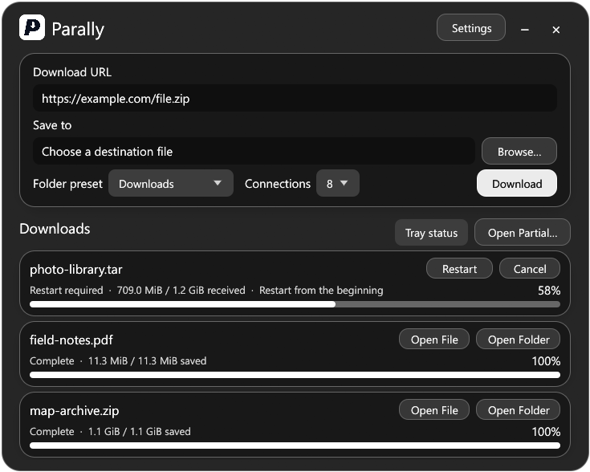
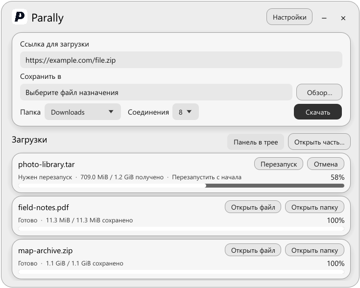

<h1 align="center">
  <picture>
    <source media="(prefers-color-scheme: dark)" srcset="assets/logo-dark.svg">
    
  </picture>
</h1>

<p align="center"><b>A fast, resumable download manager for Windows, macOS and Linux.</b><br>
Splits big files into parallel ranges, survives restarts, and takes over downloads from your browser.</p>

<p align="center">
  <a href="https://github.com/setnic/parally/releases/latest"></a>
  <a href="#install"></a>
  <a href="#build-from-source"></a>
  <a href="LICENSE"></a>
</p>

<p align="center">
  
  
</p>

<p align="center"><b>English</b> · <a href="README.ru.md">Русский</a></p>

## Features

- **Parallel ranges.** Up to 16 connections per file, with a progress bar for each range. Change the count while a download runs.
- **Resume anything.** Checkpoints survive app restarts. Before reusing saved bytes, Parally checks that the file on the server has not changed.
- **Browser handoff.** A Chromium extension sends downloads to Parally, cookies included, so logged-in and signed links work.
- **No surprises.** Never overwrites an existing file, and refuses to save a web page under a `.zip` name.
- **Small and native.** One executable, light and dark themes, adjustable transparency, a tray panel on Windows, English and Russian.

## Install

Grab the file for your system from the [latest release](https://github.com/setnic/parally/releases/latest).

| System | File |
| --- | --- |
| Windows 10/11 x64 | `Parally-*-windows-x64-setup.exe` |
| macOS, Apple silicon | `Parally-*-macos-arm64.dmg` |
| macOS, Intel | `Parally-*-macos-x86_64.dmg` |
| Debian, Ubuntu x64 | `Parally-*-linux-amd64.deb` |

The builds are not code-signed yet. Windows SmartScreen may warn on first launch (**More info → Run anyway**). On macOS, right-click the app and choose **Open** the first time.

## Browser extension

Works in Chrome, Edge, Brave, Vivaldi, Opera and Chromium.

1. In Parally: **Settings → Add Parally to a browser… → Open extension folder**.
2. In the browser: open the extensions page and turn on **Developer mode**.
3. Click **Load unpacked** and choose that folder.

Downloads then open in Parally, which asks where to save them. The toolbar button turns this off. Right-click any link for **Download with Parally**. [Details and privacy](browser/README.md)

## Build from source

You need Rust 1.95+ and, for the extension tests, Node.js. On Linux, also install the Mesa OpenGL/EGL, X11, Wayland and xkbcommon development packages.

```sh
cargo build --release
cargo test --release
node --test tests/extension.cjs
```

Installers: [packaging/windows.iss](packaging/windows.iss) (Inno Setup) on Windows, `bash packaging/unix.sh` on macOS and Debian/Ubuntu. The [installers workflow](.github/workflows/installers.yml) builds all four.

## License

[MIT](LICENSE)
