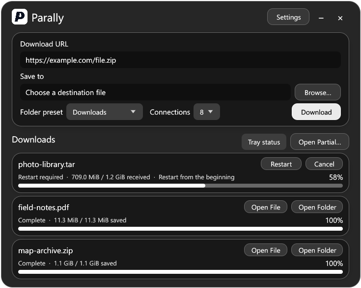
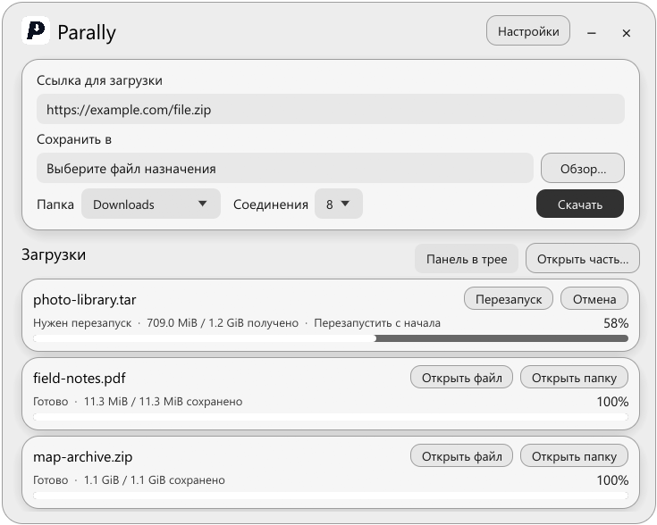

<h1 align="center">
  <picture>
    <source media="(prefers-color-scheme: dark)" srcset="assets/logo-dark.svg">
    
  </picture>
</h1>

<p align="center"><b>Быстрый менеджер загрузок с докачкой для Windows, macOS и Linux.</b><br>
Качает большие файлы в несколько потоков, переживает перезапуски и перехватывает загрузки из браузера.</p>

<p align="center">
  <a href="https://github.com/setnic/parally/releases/latest"></a>
  <a href="#установка"></a>
  <a href="#сборка-из-исходников"></a>
  <a href="LICENSE"></a>
</p>

<p align="center">
  
  
</p>

<p align="center"><a href="README.md">English</a> · <b>Русский</b></p>

## Возможности

- **Несколько потоков.** До 16 соединений на файл и полоса прогресса для каждого диапазона. Число соединений можно менять прямо во время загрузки.
- **Докачка.** Прогресс сохраняется между перезапусками. Перед докачкой Parally проверяет, что файл на сервере не изменился.
- **Перехват из браузера.** Расширение для Chromium-браузеров передаёт загрузки в Parally вместе с cookies, поэтому работают ссылки, требующие входа на сайт, и подписанные ссылки.
- **Без сюрпризов.** Никогда не перезаписывает существующие файлы и не сохранит веб-страницу под именем `.zip`.
- **Лёгкий и нативный.** Один исполняемый файл, светлая и тёмная темы, настраиваемая прозрачность, панель в трее на Windows, английский и русский интерфейс.

## Установка

Скачайте файл для своей системы из [последнего релиза](https://github.com/setnic/parally/releases/latest).

| Система | Файл |
| --- | --- |
| Windows 10/11 x64 | `Parally-*-windows-x64-setup.exe` |
| macOS, Apple silicon | `Parally-*-macos-arm64.dmg` |
| macOS, Intel | `Parally-*-macos-x86_64.dmg` |
| Debian, Ubuntu x64 | `Parally-*-linux-amd64.deb` |

Сборки пока не подписаны. При первом запуске Windows SmartScreen может предупредить: нажмите **Подробнее → Выполнить в любом случае**. На macOS в первый раз нажмите на приложение правой кнопкой и выберите **Открыть**.

## Расширение для браузера

Работает в Chrome, Edge, Brave, Vivaldi, Opera и Chromium.

1. В Parally: **Настройки → Добавить Parally в браузер… → Открыть папку расширения**.
2. В браузере откройте страницу расширений и включите **Режим разработчика**.
3. Нажмите **Загрузить распакованное расширение** и выберите эту папку.

После этого загрузки будут открываться в Parally, а он спросит, куда сохранить файл. Кнопка Parally на панели браузера выключает перехват. Чтобы отправить любую ссылку в Parally, нажмите на неё правой кнопкой и выберите **Download with Parally**. [Подробности и приватность (англ.)](browser/README.md)

## Сборка из исходников

Нужны Rust 1.95+ и, для тестов расширения, Node.js. На Linux также установите пакеты разработки Mesa OpenGL/EGL, X11, Wayland и xkbcommon.

```sh
cargo build --release
cargo test --release
node --test tests/extension.cjs
```

Установщики: [packaging/windows.iss](packaging/windows.iss) (Inno Setup) на Windows, `bash packaging/unix.sh` на macOS и Debian/Ubuntu. [Workflow установщиков](.github/workflows/installers.yml) собирает все четыре.

## Лицензия

[MIT](LICENSE)
